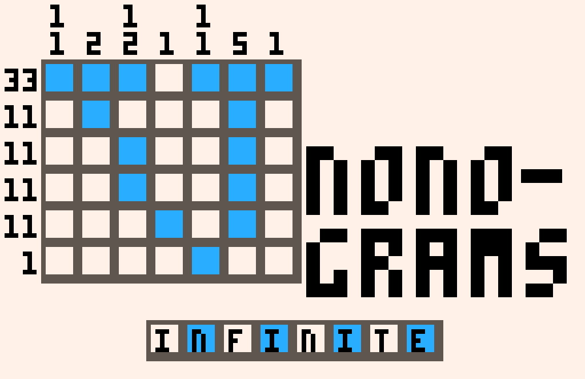
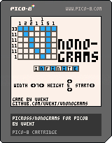
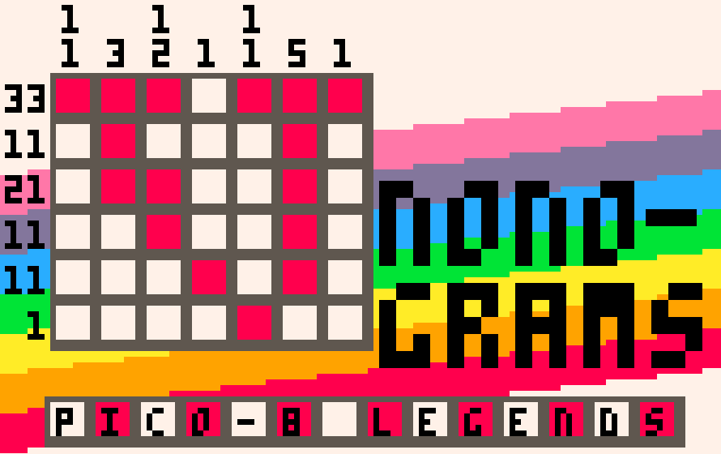
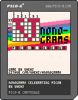
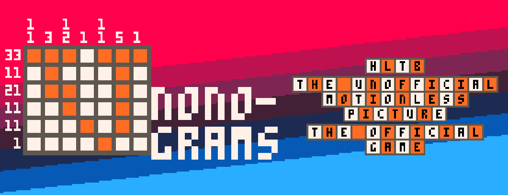
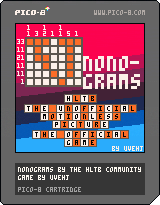

# VNonograms
 Nonograms/picross for Pico-8
 Explanation on how nonograms work from [Wikipedia](https://en.wikipedia.org/wiki/Nonogram):
 
 Nonograms [...] are picture logic puzzles in which cells in a grid must be colored or left blank according to numbers at the side of the grid to reveal a hidden picture. In this puzzle type, the numbers are a form of discrete tomography that measures how many unbroken lines of filled-in squares there are in any given row or column. For example, a clue of "4 8 3" would mean there are sets of four, eight, and three filled squares, in that order, with at least one blank square between successive sets. 
 
 ### Controls
 VNonograms uses the default Pico-8 control scheme, that being:
 
 Up/Down/Left/Right: With the arrow keys, WASD or the dpad/joystick on your controller
 
 Accept/Reveal colored tile: Z / C / N / (A) or (Y) on XBox controllers
 
 Mark tile as blank: X / V / M / (B) or (X) on Xbox controllers
 
 ## VNonograms Infinite
 
 
 VNonograms Infinite autogenerates nonogram puzzles you can solve

You can play the game on the browser or download it for Windows/Linux/Mac/RaspberryPi over at the Itch.io page

https://uvehj.itch.io/vnonograms-infinite

Or alternatively you can load the cartridge into Pico8

 
 ## VNonograms: Pico-8 Legends
 
 
 VNonograms: Pico-8 Legends is a nonogram puzzle game celebrating the Pico-8. Featuring pixel art from the Pico-8 ecosystem and community.

You can play the game on the browser or download it for Windows/Linux/Mac/RaspberryPi over at the Itch.io page

https://uvehj.itch.io/vnonograms-pico-8-legends

Or alternatively you can load the cartridge into Pico8

 ## VNonograms: HLTB: The Unofficial Motionless Picture: The Official Game
 
 
 VNonograms: HLTB: The Unofficial Motionless Picture: The Official Game is the official video game puzzler companion to the unofficial HLTB Motionless Picture. Relive iconic scenes from the film in glorious orange and white, 12x12 pixel resolution and at a blistering 0 FPS!

You can play the game on the browser or download it for Windows/Linux/Mac/RaspberryPi over at the Itch.io page

https://uvehj.itch.io/vnonograms-hltb

Or alternatively you can load the cartridge into Pico8

